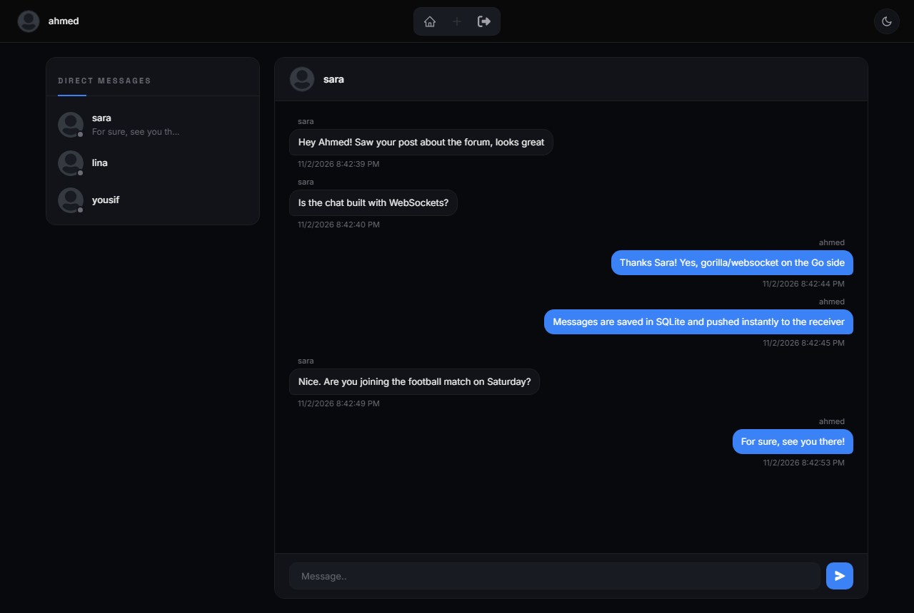
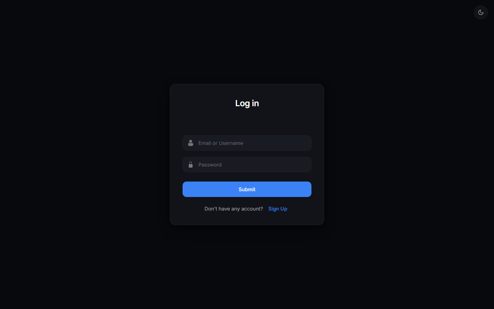
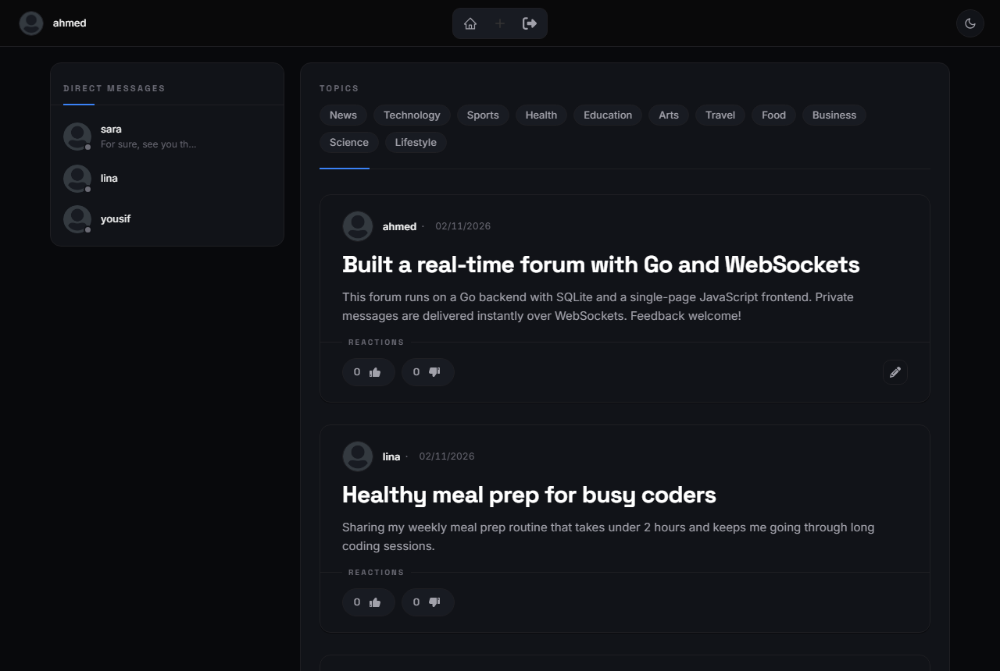
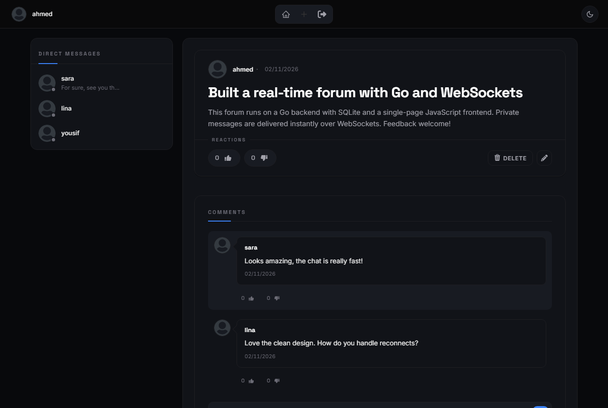
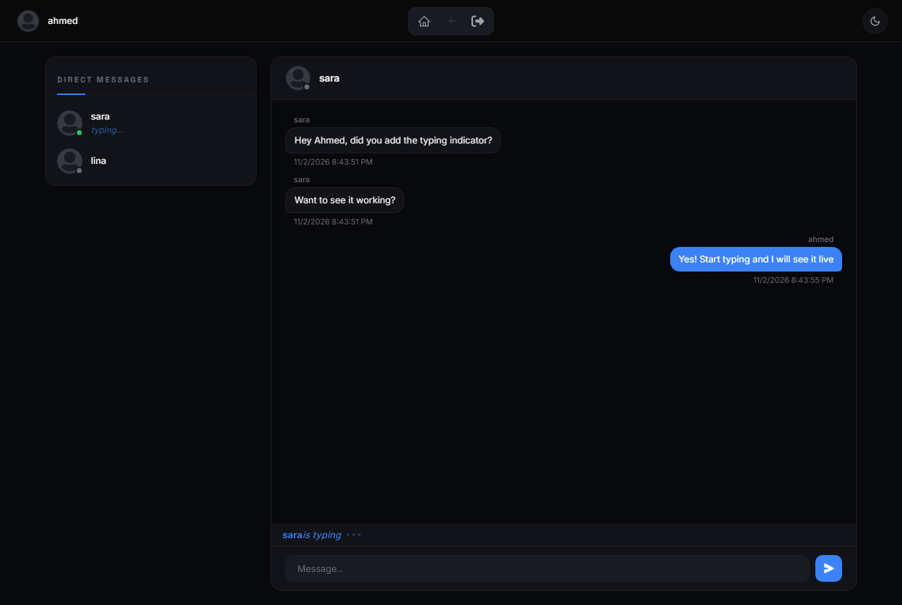

# Real-Time Forum

A single-page forum with **real-time private messaging**, built with a Go backend, SQLite and vanilla JavaScript. Users can register, publish posts in categories, comment, react, and chat one-to-one over WebSockets, all without page reloads.




## Features

### Accounts and sessions
- Registration with username, age, gender, first name, last name, email and password
- Log in with **either username or email**
- Passwords hashed with **bcrypt**
- Cookie-based sessions with UUID tokens and expiry, and a single active session per user
- Protected routes through authentication middleware

### Posts and comments
- Create posts in one or more **categories**, with optional images
- Feed of posts, and a detail view with all comments
- **Likes and dislikes** on posts and comments
- Profile pictures

### Private messages
- **Live list of users**, with online/offline status, sorted by most recent conversation
- One-to-one chat over **WebSockets**, with messages delivered instantly
- Every message shows the sender and the date
- Chat history loads **10 messages at a time** as you scroll up
- **Notifications** for unread messages

### Single-page application
- One HTML page; JavaScript handles routing and views
- Custom error pages and messages

## Screenshots

| Login | Feed |
|---|---|
|  |  |

| Post with comments | Private messages |
|---|---|
|  |  |

<sub>Screenshots use demo accounts and content.</sub>

## Tech Stack

| Layer | Technology |
|---|---|
| Backend | Go (`net/http`), `gorilla/websocket`, `google/uuid`, `bcrypt` |
| Database | SQLite (`mattn/go-sqlite3`) |
| Frontend | Vanilla JavaScript, HTML, CSS |

## Getting Started

**Requirements:** Go 1.21+ and a C compiler (gcc), because `go-sqlite3` uses cgo

```bash
git clone https://github.com/ahmed-jawher/real-time-forum.git
cd real-time-forum
go run .
```

Open <http://localhost:8082>. The database tables are created automatically on first start.

## API Overview

| Route | Description |
|---|---|
| `/` · `/SignUp` · `/LogOut` | Authentication |
| `/HomePage` | Post feed (authenticated) |
| `/CreatePost` · `/Post/{id}` | Create and view posts |
| `/CommentHandler` · `/CommentLikeHandle` | Comments and reactions |
| `/Chat` · `/ws` | Private messaging and the WebSocket connection |
| `/Notifications` | Unread message notifications |

## Project Structure

```text
real-time-forum/
├── main.go                 # routes and server (port 8082)
├── Backend/                # handlers, sessions, WebSocket hub, DB setup, tests
├── Js/                     # SPA: routing, auth, posts, comments, chat
├── Style/                  # CSS
├── Pages/forum.html        # the single HTML page
├── DataBase/               # SQLite files
└── real-time-forum-typing-in-progress/   # extension (see below)
```

## Extension: Typing in Progress

[`real-time-forum-typing-in-progress/`](real-time-forum-typing-in-progress) builds on this project and adds a **live "is typing…" indicator** to private chats.



## Testing

```bash
go test ./Backend/...
```

The tests cover the post handler and concurrent access.

## Author

**Ahmed Jawher** — [@ahmed-jawher](https://github.com/ahmed-jawher)
